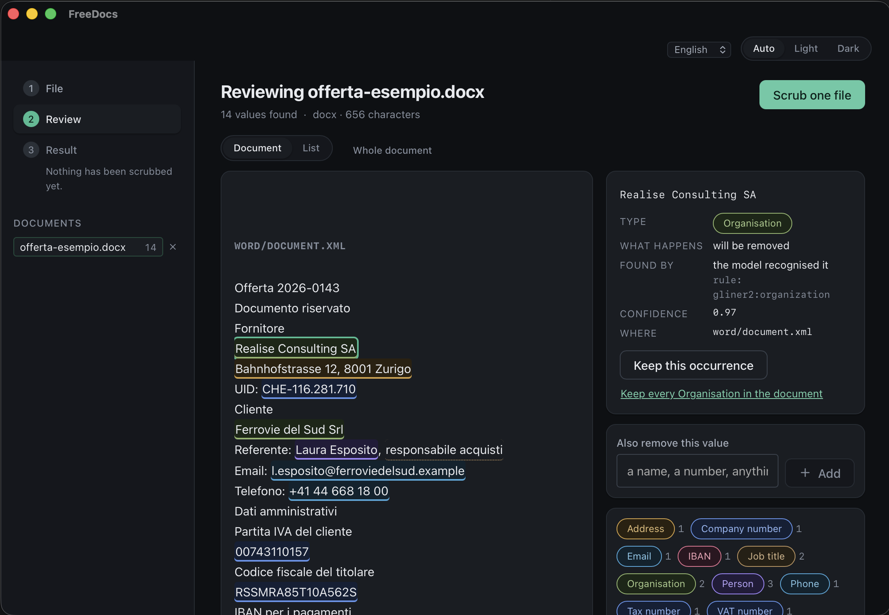
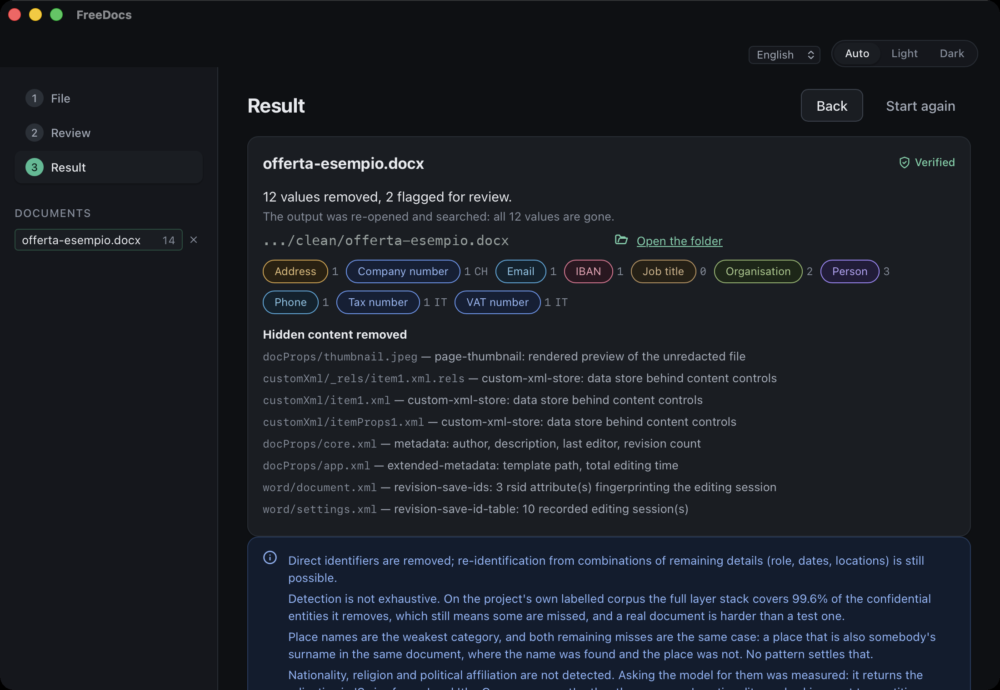

<p align="center">
  <picture>
    <source media="(prefers-color-scheme: dark)" srcset="docs/images/wordmark-dark.svg">
    
  </picture>
</p>

<h3 align="center">Take the confidential data out of a document before an AI ever sees it.</h3>

<p align="center">
  PDF, Word, Excel, PowerPoint and scans — in, redacted, and out in the same format.<br>
  On your machine. No cloud, no API key, no telemetry, no account.
</p>

<p align="center">
  <a href="LICENSE"></a>
  
  
</p>

<p align="center">
  <b>English</b> ·
  <a href="README.it.md">Italiano</a> ·
  <a href="README.de.md">Deutsch</a> ·
  <a href="README.fr.md">Français</a>
</p>

---

Most tools that promise this hand you back a text file, or draw black rectangles
over text that is still selectable underneath. FreeDocs edits the document in
place — and then it re-opens what it wrote, re-extracts it including the parts you
cannot see, and **fails the run if a single redacted value survived**.

<p align="center">
  
</p>

<p align="center"><sub><b>Review.</b> Every finding is marked in the document itself, because the sentence around a value is what says whether a city is a party's address or a jurisdiction clause. The panel names the layer that found it, its confidence, and the part of the file it lives in.</sub></p>

<p align="center">
  
</p>

<p align="center"><sub><b>Result.</b> What went, which hidden parts were dropped, and the line that matters: the output was re-opened and searched, and all twelve values are gone. The output path is painted over in this screenshot — an unretouched one would publish a username, which is the class of thing this tool exists to remove. Nothing else is edited.</sub></p>

## The 30-second version

```console
$ freedocs scrub examples/offerta-esempio.docx -o clean/
offerta-esempio.docx  [docx]
  removed:
    ADDRESS                1
    COMPANY_ID             1
    EMAIL                  1
    IBAN                   1
    ORGANISATION           2
    PERSON                 3
    PHONE                  1
    TAX_ID                 1
    VAT_ID                 1
  flagged for review: 2
  hidden content removed:
    docProps/thumbnail.jpeg page-thumbnail             rendered preview of the unredacted file
    customXml/_rels/item1.xml.rels custom-xml-store           data store behind content controls
    customXml/item1.xml custom-xml-store           data store behind content controls
    customXml/itemProps1.xml custom-xml-store           data store behind content controls
    docProps/core.xml metadata                   author, description, last editor, revision count
    docProps/app.xml extended-metadata          template path, total editing time
    word/document.xml revision-save-ids          3 rsid attribute(s) fingerprinting the editing session
    word/settings.xml revision-save-id-table     10 recorded editing session(s)
  verify: no leak: 12 distinct values checked against 564 characters of output
  written: clean/offerta-esempio.docx
```

That run is reproducible — the file is [`examples/offerta-esempio.docx`](examples/) —
and this is what came out of it:

| Before | After |
|---|---|
| Realise Consulting SA<br>Bahnhofstrasse 12, 8001 Zurigo<br>UID: CHE-116.281.710 | `[ORGANISATION_1]`<br>`[ADDRESS_1]`<br>UID: `[COMPANY_ID_1]` |
| Referente: Laura Esposito, responsabile acquisti | Referente: `[PERSON_1]`, responsabile acquisti |
| IBAN per i pagamenti: CH93 0076 2011 6238 5295 7 | IBAN per i pagamenti: `[IBAN_1]` |
| …il foro competente è **Zurigo**. | …il foro competente è **Zurigo**. |

Look at the last row. The city in the party's address is gone; the same city in
the governing-law clause is untouched, because a jurisdiction identifies nobody.
And `Laura Esposito` was stored by Word as three separate runs — it came out as
one placeholder, with the paragraph's formatting, the table and the styles intact.

## What you get

- **The same file type back, still formatted.** Runs, tables, charts and styles
  survive, because write-back edits the runs and the PDF content stream instead of
  flattening the document to text. Parts the engine never parsed are copied
  through as the bytes they arrived as.
- **The copies you did not know were there.** Excel pivot caches, chart caches and
  `veryHidden` sheets; Word's deleted-but-tracked text, `customXml` store and
  rendered page thumbnail; PowerPoint speaker notes, hidden slides, off-canvas
  shapes and the entire workbook embedded inside a chart. Every item is removed or
  redacted, and named in the report. → [what a document hides](docs/hidden-content.md)
- **A verification stage that can fail.** Stage 6 re-opens the output,
  re-extracts it and searches for every value that was supposed to be gone. A
  survivor exits non-zero and **nothing is written**, because a nearly-clean file
  is more dangerous than an obviously dirty one — it gets sent.
- **Numbers you can re-run.** `freedocs benchmark` scores the layers against an
  annotated corpus, and the tool prints its own caveat every time.
  → [benchmark](docs/benchmark.md)
- **Optionally, the way back.** `--map` writes an encrypted key file, and
  `freedocs restore` puts the real values into whatever the model hands back. Off
  by default, because it is the one thing that makes a scrub reversible: without
  it the mapping is destroyed at the end of the run and nobody can undo it,
  including you. → [the reverse path](docs/restore.md)

## Quickstart

**Command line**

```bash
git clone https://github.com/MarcoTribuz/FreeDocs.git
cd FreeDocs/engine
uv sync --extra dev --extra pdf --extra ooxml --extra ner   # ner fetches ~1.2 GB of model weights

uv run freedocs inspect ../examples/offerta-esempio.docx    # report, write nothing
uv run freedocs scrub   ../examples/offerta-esempio.docx -o out/
uv run freedocs doctor                                      # what this machine can actually do
```

Without `--extra ner` everything still works on checksums alone, and every report
states that names, organisations, locations and addresses are not being detected.
A build that finds less has to say so. → [full CLI reference](docs/cli.md)

**Desktop app**

```bash
cd app && npm install
npm run tauri build     # or: npm run tauri dev
```

There is no signed release to download yet. The installers are built in CI for
macOS, Linux and Windows on every push to `main`; macOS is the only one that has
been launched by a human, so read "builds" and not "works" for the other two.
→ [packaging](docs/packaging.md)

There is also a portable bundle per platform — unzip and run, no installer, no
network, the 1.2 GB model carried inside it rather than downloaded on first use.
It is 1405 MB for that reason. → [portable](docs/portable.md)

## What it finds

| | |
|---|---|
| **Formats** | plain text, PDF (born-digital and scanned), `docx`, `xlsx`, `pptx` |
| **Removed** | person, organisation, address, location, email, phone, IBAN, credit card, national ID, tax ID, VAT ID, company registration ID, IP, MAC, URL |
| **Flagged, never removed** | job title, date, age, postcode — quasi-identifiers, because deleting one hides residual risk instead of surfacing it |
| **Checksum-confirmed identifiers** | 🇨🇭 🇮🇹 🇩🇪 🇦🇹 🇫🇷 🇧🇪 🇪🇸 🇵🇹 🇳🇱 🇵🇱 🇸🇪 🇬🇧 — twelve countries, forty rules |
| **Languages read** | Italian, German, French, English, from one model with no language hint |

`freedocs countries` prints what each country actually gets. The United States is
in that list with no checksum rules at all, because neither of its numbers has a
check digit — `stdnum.us.ssn` accepts 89% of random values of its shape. Those
identifiers come from the model instead, and the tool says so rather than
pretending a rule into the table.

## How it decides

Three layers, and the strict one gets the last word.

**Checksums first.** A regex nominates, a check digit decides. Forty rules over
twelve countries, every validator from `python-stdnum`. Confidence per rule is a
measurement, not a judgement: each validator was run against 20 000 random
format-plausible values to count how many it accepts, and the weakest rules sit
below the default threshold — found and reported, never removed, unless a word
naming them is nearby.

**Then a multilingual encoder** (GLiNER2 on `mdeberta-v3-base`) for the things no
checksum can confirm: names, organisations, locations, addresses, job titles. One
model, four languages, no language hint — and it must return character offsets,
because offsets are what the anchors need.

**Then the checksums audit the model.** GLiNER2 labelled two adjacent chart
amounts a credit card at 0.87 confidence; no threshold separates that from a real
finding, and Luhn settles it in one call. When the model claims a structured type,
the matching checksum has the final say — except where there is no way to know
which country issued it, in which case there is no opinion and the finding
survives.

Three corrective passes then clean up the free-text layer: an address is assembled
outwards from its postal code (the part that needs no model), a company name is
recovered from the legal form that follows it, and findings that name something
real but identify nobody are dropped. That last one is why `Zurigo` stayed in the
governing-law clause above. → [architecture](docs/architecture.md)

## Measured, not promised

537 annotated entities across Italian, German, French and English business
documents; 485 of them are entities the policy actually removes.

| Layers | Coverage | Over-redaction | Exact micro-F1 |
|---|---|---|---|
| Checksums only | 70.3% | 1.1% | 0.738 |
| Encoder only | 86.6% | 1.7% | 0.793 |
| **Both (default)** | **99.6%** | **2.2%** | **0.929** |

**Coverage** is gold entities *fully* removed — a partial span is a leak, because
`Rossi` left behind still identifies someone. **Over-redaction** is characters
removed that were not confidential, because a detector that redacts the page leaks
nothing and is useless. F1 is reported third on purpose: it is the number that
looks best and matters least here.

Reproduce any row with `--detectors l1`, `--detectors ner`, or no flag at all;
`--apply-min-confidence 0.5` reports what a scrub does rather than what the
detector nominated. **The corpus is small and synthetic — these numbers rank
configurations against each other and are not a published benchmark result.** The
tool prints that caveat itself, every time. → [benchmark](docs/benchmark.md)

## What it does not do

The honest list, because the failures of a tool like this are silent by nature.

- **It does not eliminate re-identification risk.** A document stripped of every
  name can still say "the only female partner in the Lugano office, hired in
  March 2019". Quasi-identifiers are flagged and reported, never silently
  rewritten. An opt-in local-LLM pass exists to *read* the anonymised output and
  point at exactly that — advisory, and it never edits.
  → [the second opinion](docs/llm-review.md)
- **On a scan, OCR is a reading and not the text.** A tax number with one
  character misread fails its checksum, is never detected, and survives. Every
  machine-read page is named in a warning telling you to check it by eye.
- **Place names that double as surnames are the weak spot.** Both remaining
  corpus leaks are a city that also appears as somebody's surname in the same
  document. LOCATION coverage is 94.3% against 100% for PERSON.
- **Redacting an Excel name renames the thing.** Formulas refer to sheets and
  tables by name, so a redacted sheet name breaks the references to it. It is done
  anyway — leaving the name would fail the leak check — and reported as a warning
  naming what changed.
- **A macro project cannot be redacted, only removed.**
- **A key file is as confidential as the original document.** If you ask for one
  with `--map`, that file can put every removed value back. It is encrypted and
  refused inside the output folder, and after that it is yours to handle: never
  send it with the scrubbed copy. It also cannot bring back content that was
  *removed* rather than replaced — thumbnails, metadata, hidden slides — because
  those were never given a placeholder. → [the reverse path](docs/restore.md)
- **It is not a compliance guarantee and never claims the output is clean.**
  `report.CAVEATS` states the limits in the report itself.

## Why another one of these

Several tools do part of this. The gap column is what FreeDocs was built for.

| Project | Formats | Detection | Gap |
|---|---|---|---|
| [rizzo-pii](https://github.com/Rizzo-AI-Academy/rizzo-pii) | txt, md, PDF | mmBERT + checksums, 22 Italian entities | no Office formats |
| [A5-PII-Anonymizer](https://github.com/AgenticA5/A5-PII-Anonymizer) | txt, docx, xlsx, csv, pdf | Piiranha ONNX | weak detector, no OCR, no pptx |
| [phileas](https://github.com/philterd/phileas) | pdf, docx, xlsx, csv, scans | regex + ML | no pptx |
| [desktop-redactor](https://github.com/williape/desktop-redactor) | csv, json, txt | Presidio | no documents |
| [Presidio](https://github.com/microsoft/presidio) | text, images, structured data | NLP + patterns | no language detection, so every language is merged: measured here at 21.5% over-redaction |

## Status

Everything in the original plan is shipped, plus international coverage: twelve
countries of checksum-confirmed identifiers, four languages of NER, a desktop app
and the opt-in review layer. Anything further is new work rather than a remaining
milestone.

<details>
<summary>The milestones, for the record</summary>

| M | Content | Status |
|---|---|---|
| M0 | Core, L1 validators, plain text, CLI, verify, tests | done |
| M1 | PDF text: true content-stream redaction, hidden-content scrub | done |
| M2 | L2 NER integrated, labelled corpus, measured coverage | done |
| M3 | `docx` with run-aware write-back and hidden-content scrub | done |
| M4 | `xlsx`, including pivot caches and `veryHidden` sheets | done |
| M5 | `pptx`: notes, hidden slides, off-canvas shapes, chart data | done |
| M6 | Scanned PDF: OCR plus redaction on word bounding boxes | done |
| M7 | Tauri desktop app | done |
| M8 | L3 Ollama review, opt-in | done |

</details>

Known gaps, stated rather than hidden: no Intel macOS build (needs an Intel
machine), no signed release yet, no Tesseract binary in the portable bundle (it
cannot be — PyMuPDF shells out to it), and torch is 501 MB of a 1.0 GB bundle that
an ONNX export would mostly remove — after re-running the benchmark to prove the
numbers hold. The installer set still ships no AppImage; the portable build makes
one.

## Contributing

Bug reports are welcome, and one rule matters more than the rest: **never attach a
real document.** Build a synthetic file that reproduces the problem — the issue
template says the same thing at the top.

- [CONTRIBUTING.md](CONTRIBUTING.md) — setup, the test markers, and the four rules
  that are not obvious from the code
- [SECURITY.md](SECURITY.md) — the threat model, and how to report a vulnerability
  privately
- [docs/](docs/) — the long version of everything above

## Licence

[AGPL-3.0-or-later](LICENSE). The PDF layer uses PyMuPDF, which is AGPL; staying
AGPL is what makes that free to use. Derivative works must stay open.
